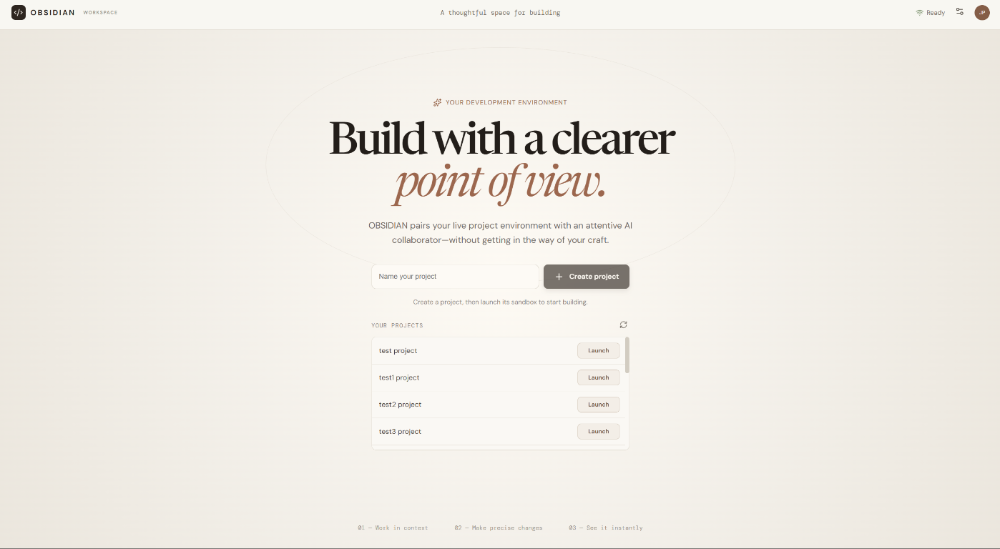
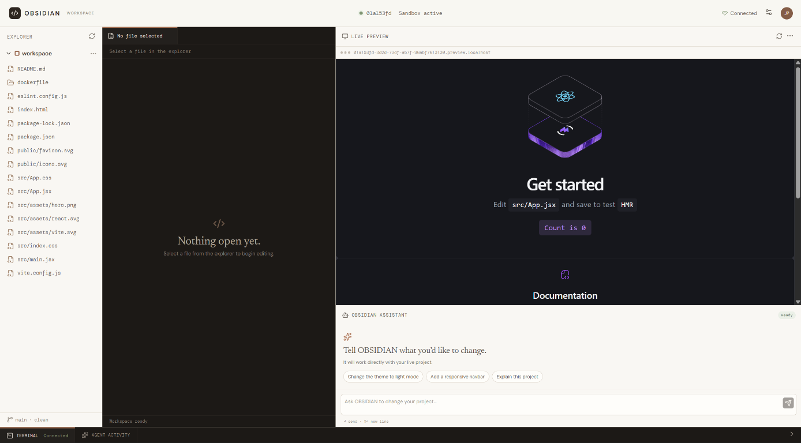

# OBSIDIAN

OBSIDIAN is a browser-based development workspace for React projects. It brings a code editor, live preview, terminal, and AI coding assistant together around an isolated, on-demand project sandbox.

## Overview

The React frontend talks to a set of Node.js services. Users can create and launch projects, edit files in a sandbox, preview changes, use a terminal, and ask an AI agent to inspect or update project files. Kubernetes provisions sandbox workloads; a sidecar syncs project files with Amazon S3.

## Features

- Create and list user projects.
- Launch an isolated React + Vite workspace for a project.
- Browse and edit workspace files with Monaco Editor; refresh the live preview after saving.
- Use a browser terminal backed by a PTY and Socket.IO.
- Send prompts to an AI agent, receive progress over server-sent events, and apply file changes.
- Persist workspace files to S3 and remove idle sandbox resources after their Redis key expires.
- Authenticate through Google OAuth in the auth service and issue an HTTP-only JWT cookie.
- Queue login notifications through RabbitMQ for email delivery.

## Tech stack

| Area | Technologies |
| --- | --- |
| Frontend | React 19, Vite, Monaco Editor, xterm.js, Socket.IO client |
| Backend | Node.js (ES modules), Express |
| AI | LangChain agent with an NVIDIA-hosted model |
| Identity and data | Google OAuth 2.0, JWT, MongoDB with Mongoose |
| Messaging and cache | RabbitMQ, Redis |
| Sandboxes and deployment | Kubernetes, Skaffold, Docker, AWS ECR, S3, CloudFront |

## Architecture

```text
Browser (React/Vite)
  ├── /api/auth  ──> Auth service ──> MongoDB
  │                                └──> RabbitMQ ──> Notification service ──> Email
  ├── /api/sandbox ─> Sandbox manager ──> MongoDB, Redis, Kubernetes API
  └── /api/ai ──────> AI orchestration ──> AI model provider

Sandbox router ──> per-project Kubernetes sandbox
                     ├── React + Vite template
                     ├── workspace agent (files and terminal)
                     └── S3 sync agent
```

The sandbox manager creates a pod and service for a project sandbox. The router forwards preview and agent traffic to that sandbox. The AI orchestration service streams agent progress and uses tools to list, read, and update workspace files. Redis expiration triggers sandbox cleanup.

## Project structure

| Path | Responsibility |
| --- | --- |
| `frontend/` | React workspace UI, API clients, editor, preview, assistant, and terminal |
| `auth/` | Google OAuth, user records, JWT cookie, and login event publishing |
| `ai-orchestration/` | AI invocation endpoint, streaming, model, and file-operation tools |
| `notification/` | RabbitMQ consumer and email delivery |
| `sandbox/server/` | Project API, authentication middleware, and Kubernetes sandbox lifecycle |
| `sandbox/router/` | HTTP and WebSocket proxying to sandbox workloads |
| `sandbox/agent/` | Workspace file operations and PTY/Socket.IO terminal |
| `sandbox/sync-agent/` | S3 restore and workspace file synchronization |
| `sandbox/templates/` | React + Vite project template used to seed sandboxes |
| `k8s/`, `skaffold*.yml` | Kubernetes resources and Skaffold build/deploy configuration |
| `scripts/` | Deployment helper scripts |

## Installation

There is no root package manifest. Use Node.js 24 (the version used by the service Dockerfiles) and install dependencies in the packages you need:

```sh
cd frontend && npm install
cd ../auth && npm install
cd ../ai-orchestration && npm install
cd ../notification && npm install
cd ../sandbox/server && npm install
cd ../router && npm install
cd ../agent && npm install
cd ../sync-agent && npm install
cd ../templates && npm install
```

Each service and the sandbox template has its own package manifest and dependency set.

## Environment variables

Provide values through the environment of each service. The table lists variable **names only**; use your own local or deployment values and do not commit credentials.

| Service | Variables |
| --- | --- |
| Auth | `MONGO_URI`, `RABBITMQ_URL`, `GOOGLE_CLIENT_ID`, `GOOGLE_CLIENT_SECRET`, `JWT_SECRET` |
| AI orchestration | `NVIDIA_API_KEY` |
| Notification | `RABBITMQ_URL`, `EMAIL_USER`, `GOOGLE_CLIENT_ID`, `GOOGLE_CLIENT_SECRET`, `GOOGLE_REFRESH_TOKEN` |
| Sandbox manager | `MONGO_URI`, `REDIS_URI`, `JWT_SECRET`, `SANDBOX_BASE_DOMAIN` (optional) |
| Sandbox router | `REDIS_URI` |
| Sandbox agent | `ALLOWED_ORIGINS` (optional, comma-separated) |
| S3 sync agent | `PROJECT_ID`, `AWS_REGION`, and AWS credentials or an AWS credential provider |
| Frontend build | `VITE_SANDBOX_ROUTING` (`path` or `host`), `VITE_SANDBOX_ORIGIN`, `VITE_SANDBOX_AGENT_DOMAIN` (optional) |

The frontend defaults to path-based sandbox routing. Configure the frontend, router, DNS, and ingress consistently if using host-based routing. The auth and notification services also rely on OAuth callback and email-provider configuration in their source.

## Running locally

To run the frontend development server:

```sh
cd frontend
npm install
npm run dev
```

Vite serves the UI at `http://localhost:5173`. Its `/api` proxy targets `http://localhost`, so API-backed features require a local gateway/ingress listening on port 80 and routing requests to the services.

Backend packages expose `npm run dev` (the sync agent exposes `npm start`). Run the services with their required environment variables and dependencies configured. A complete local workflow also requires MongoDB, Redis, RabbitMQ, an AI provider key, AWS access for S3 synchronization, and Kubernetes access for sandbox creation. The services are configured on overlapping container ports, so they need separate containers or a Kubernetes environment; this repository does not include a root Compose setup.

## API overview

| Endpoint | Description |
| --- | --- |
| `GET /api/auth/google` | Start Google OAuth |
| `GET /api/auth/google/callback` | Complete OAuth, issue the JWT cookie, and publish a login notification |
| `GET /api/sandbox/project` | List the authenticated user's projects |
| `POST /api/sandbox/project` | Create a project (`title`) |
| `POST /api/sandbox/create` | Launch a sandbox for a project (`projectId`) |
| `POST /api/ai/invoke` | Invoke the AI agent (`message`, `projectId`, `sandboxId`); responds as an SSE stream |
| `GET /list-files` | List files in a sandbox workspace |
| `GET /read-files?files=<path>` | Read workspace file contents |
| `PATCH /update-files` | Update files in a workspace |
| `POST /create-files` | Create workspace files |
| Socket.IO | Terminal input, output, resize, and exit events |

Project and sandbox management endpoints require a valid JWT cookie or bearer token. The sandbox agent routes are proxied by the router and use the configured sandbox routing strategy.

## Screenshots and demo

### Project dashboard



### Workspace editor, preview, assistant, and terminal



> Live demo: add a public URL when available.

## Deployment

The repository includes Dockerfiles for the services and a Skaffold Kubernetes deployment configuration. `skaffold.yml` targets the configured Kubernetes context; `skaffold-eks.yml` describes the EKS/ECR build configuration. Deployments require a working cluster, image-registry access, the Kubernetes secrets referenced by the deployments, and the required database, messaging, cache, OAuth, AI, and AWS resources.

The frontend has separate S3 and CloudFront configuration files. Build its static assets with:

```sh
cd frontend
npm run build
```

Deploy the generated `frontend/dist/` directory to the configured static hosting origin and serve it through CloudFront.

## Future improvements

- Add automated tests and a root-level development workflow.
- Document reproducible local infrastructure and deployment prerequisites.
- Align and validate the sandbox routing modes across the frontend, router, and ingress.
- Add API schema documentation and operational guidance.

## License

No root `LICENSE` file is present. Confirm the project's intended license and add a license file before redistribution. Individual package manifests specify ISC, but do not define a repository-wide license.
